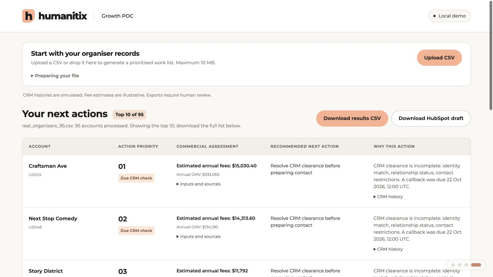

# Humanitix US Sales Priority Engine

**Which organisers deserve sales attention, and what should happen next?**

An independent GTM Engineering proof of concept by Santiago Gonzalez Alvarez. It turns an organiser CSV into a ranked work list with a commercial assessment, a next action and an explanation.

**[Watch the demo on YouTube (9:34)](https://youtu.be/9GiAXAyxHyM)**

[](https://github.com/sgon0181/humanitix-sales-priority-engine/actions/workflows/tests.yml)

[](https://youtu.be/9GiAXAyxHyM)

Inspect the generated [ranked results](examples/ranked_accounts.csv) or [HubSpot task draft](examples/hubspot_tasks_REVIEW_DRAFT.csv) without running the app.

## The idea

Help a small sales team make better use of its existing organiser database. Recurring paid events can create annual fee opportunity, while callbacks, contact restrictions and recent interactions determine the appropriate next task.

**Upload CSV -> Qualify -> Prioritise -> Explain -> Download**

- **Commercial value:** estimate annual paid tickets, gross ticket sales and illustrative gross fees.
- **Action priority:** respect callbacks, replies, existing relationships, restrictions and cooldowns.
- **Useful output:** show the top 10 accounts; download the complete ranked list and HubSpot-compatible company, note and task review drafts.

A high-value account does not automatically become the next account to call. Missing inputs stay **Unknown**.

## Try it locally

Python 3.12 or newer. Standard library only; no packages, API keys or HubSpot account required.

```bash
git clone https://github.com/sgon0181/humanitix-sales-priority-engine.git
cd humanitix-sales-priority-engine
python3 demo.py
```

Open **http://127.0.0.1:8765** for the three-slide introduction and working demo. Upload one of these files:

| Example | What it demonstrates |
| --- | --- |
| [95 real organiser identities](data/csv_examples/real_organisers_95.csv) | Preserved public research with separately simulated commercial and CRM inputs |
| [50 fictional organisers](data/csv_examples/fully_synthetic_organisers.csv) | A fully fictional batch with varied contact histories |
| [Blank 15-field template](data/csv_examples/organisers_template.csv) | Bring another batch without changing code or supplying priorities |

## Evidence and limits

The research contains 95 real organiser identities, selected public-source checks on 20 records and 75 unreviewed records. These are not 95 verified or sales-qualified leads.

**All demo commercial volumes, fee estimates and CRM histories are simulated.** Default fees of 4% + $1 per paid ticket are configurable, illustrative assumptions, not verified Humanitix pricing. Gross fees are not profit, a revenue forecast or measured uplift. No outreach or live CRM integration occurs. Handoff files require human review and field/owner mapping.

## Under the hood

The Python decision engine is covered by **152 automated tests**, including missing data, fee ranking, callbacks, restrictions, cooldowns, provenance and handoff safeguards.

```bash
python3 -m unittest discover -s tests -v
```

[Commercial decisions and pilot proposal](docs/approach.md) · [Data and provenance](data/README.md) · [CSV field guide](data/csv_examples/README.md)

Independent interview project. Not an official Humanitix product or an analysis of its internal CRM.
